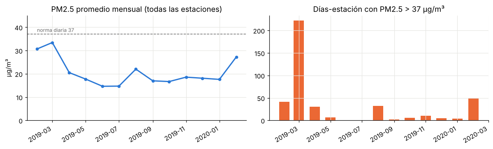
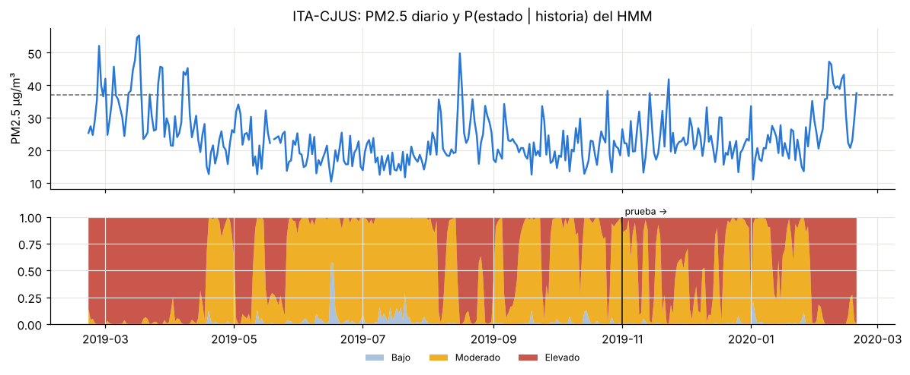
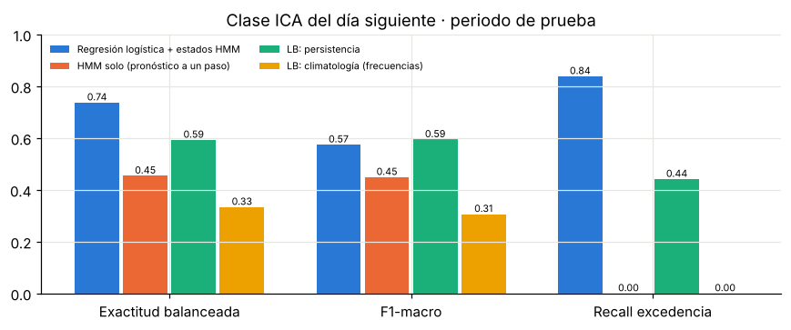

## 1. Problema

En el Valle de Aburrá el PM2.5 es el contaminante que más afecta la salud y el que suele definir el Índice de
Calidad del Aire (ICA). La topografía de un valle estrecho y las temporadas de transición (febrero–abril,
octubre–noviembre) producen episodios en los que el promedio diario supera la norma nacional de 37 µg/m³
(Res. 2254 de 2017). SIATA publica las mediciones, pero un ciudadano rara vez sabe qué significa el número
del día, qué esperar mañana ni qué recomiendan las autoridades. Construimos un MVP que (i) estima el régimen
latente de contaminación y pronostica la categoría del día siguiente por estación con modelos implementados
por el equipo y (ii) los expone mediante un agente LLM que consulta datos, modelos y normativa, y responde
con citas, dentro de un dashboard interactivo.

## 2. Datos

**PM2.5 horario de SIATA – AMVA** (archivo oficial `EntregaData1/Datos_SIATA_Aire_pm25.json`): 21 estaciones
(19 poblacionales y 2 de tráfico), 21-feb-2019 → 20-feb-2020, 183 981 registros. El script de descarga
prueba la URL oficial, luego un espejo público y por último la copia del repositorio (plan B). Al verificar
el acceso (12-nov-2026) la URL oficial respondió, pero ya publica otro periodo, 2023-07-31 → 2024-07-30
(184 485 registros, solo 74.9 % válidos frente a 97.3 % del periodo usado). Por eso el proyecto fija una
copia versionada: una descarga nueva se guarda aparte y no reemplaza los datos con que se entrenó y evaluó. Limpieza: se
descartan centinelas (−9999), banderas de calidad > 2.5 y valores fuera de 0–500 µg/m³ (queda el 97.3 %);
promedio diario con ≥ 18 h válidas (75 % de representatividad) → 7 525 días-estación. La clase objetivo es
*Buena* (≤12), *Aceptable* (12–37) o *Dañina* (>37 µg/m³), con la misma regla de redondeo del ICA. Solo el
3.3 % de los días-estación supera la norma. El EDA (Fig. 1) muestra el pico de feb–mar 2019, un episodio en
agosto de 2019 (16-ago: 84 % de estaciones sobre la norma), menor PM2.5 los domingos (17 vs 21–22 µg/m³
entre semana) y una autocorrelación diaria alta, que hace de la persistencia una línea base exigente.

{width=92%}

**Corpus RAG** (8 documentos, 43 fragmentos): Res. 2254/2017 (norma, ICA y niveles de prevención/alerta/
emergencia), POECA del AMVA (Acuerdo Metropolitano 04/2018 y plan de acción municipal), recomendaciones de
salud por color del ICA (SIATA, Cornare), guías OMS 2021, geografía del valle y red SIATA, y la metodología
del propio proyecto. Son resúmenes parafraseados con la URL de la fuente oficial.

## 3. Parte 1: HMM y clasificador (implementación propia)

**HMM gaussiano.** Modelamos log(PM2.5) diario de cada estación con un HMM de 3 estados y emisiones
gaussianas, con parámetros compartidos entre estaciones. Implementamos en NumPy el algoritmo
forward-backward con escalado, Baum-Welch sobre múltiples secuencias, Viterbi en espacio logarítmico,
marginalización de días faltantes (verosimilitud de emisión = 1) y la predicción a un paso
$P(s_{t+1}\mid y_{1:t})=\alpha_t A$, que integrada sobre los intervalos de cada clase da un pronóstico
probabilístico. Los estados aprendidos tienen medias de 11.5, 17.7 y 30.0 µg/m³ y alta persistencia
(duración esperada 17, 13 y 18 días); los llamamos *Bajo, Moderado* y *Elevado*. Las pruebas automáticas
verifican la verosimilitud y Viterbi contra la enumeración exhaustiva de secuencias, la monotonía de EM y la
recuperación de parámetros en datos simulados.

**Clasificador del día siguiente.** Regresión logística multinomial (Adam, L2, pesos de clase) y Naive Bayes
gaussiano, ambos propios. Variables en el día *t*: log-PM2.5 de *t* y *t−1*, media de 3 días, cambio diario,
media regional, **probabilidades filtradas del HMM** (causales, sin fuga de información), fin de semana y mes
(seno/coseno) del día objetivo. **Protocolo:** entrenamiento hasta 31-oct-2019 y prueba 1-nov-2019 →
20-feb-2020 (2 238 casos, 68 con norma excedida). Los pesos de clase y L2 se eligen con validación temporal
en los últimos 5 meses del entrenamiento (F1-macro; desempate fijado de antemano por log-loss). Adicionalmente
evaluamos con ventana creciente en 6 meses (sep-2019 → feb-2020), reentrenando el HMM en cada pliegue.
Líneas base: persistencia (mañana = hoy), climatología (frecuencias de entrenamiento) y el HMM solo.

{width=92%}

## 4. Parte 2: agente LLM con RAG

El agente sigue un **loop manual** (Clase 12): el LLM recibe el mensaje del sistema, el contexto del tablero
(estación y fecha), el historial y los esquemas de 5 herramientas; si pide herramientas, se ejecutan y su
resultado vuelve como mensaje `tool`; el ciclo termina con una respuesta o al llegar a **Tmáx = 6** pasos, en
cuyo caso se fuerza la respuesta con `tool_choice="none"`. Herramientas: `get_pm25` (medición diaria, serie,
categoría ICA; intento opcional en vivo con respaldo histórico), `predict_tomorrow` (modelos de la Parte 1),
`estado_regional` (porcentaje de estaciones poblacionales sobre la norma y nivel indicativo con el criterio
del 50 % de estaciones del art. 12 de la Res. 2254), `listar_estaciones` y `search_docs` (RAG). **Errores:**
toda excepción de una herramienta se devuelve como `{"error": ...}` para que el LLM corrija argumentos (por
ejemplo una fecha fuera del histórico); si el proveedor LLM falla, se reintenta una vez y luego responde un
router determinista con las mismas herramientas, avisando al usuario. **RAG:** fragmentación por secciones,
embeddings TF-IDF (palabras 1–2 gramas sin tildes con stopwords + n-gramas de caracteres) u opcionalmente
`sentence-transformers`, índice FAISS de producto interno y expansión de consulta con un tesauro del dominio.
**Citas:** cada fragmento y herramienta trae un código (`[POECA]`, `[SIATA-DATOS]`, `[MODELO]`…) que el
LLM debe incluir; se extraen y se muestran con su URL. LLM por defecto: Groq `openai/gpt-oss-120b`.

## 5. Resultados

| Modelo (periodo de prueba) | Exact. | F1-macro | Exact. bal. | Recall exced. | Log-loss |
|---|---|---|---|---|---|
| Regresión logística + HMM | 0.768 | 0.574 | **0.737** | **0.838** | 0.522 |
| Regresión logística sin HMM (ablación) | 0.783 | 0.583 | 0.732 | 0.838 | 0.530 |
| Naive Bayes + HMM | 0.641 | 0.484 | 0.736 | 0.912 | 2.093 |
| HMM solo | 0.834 | 0.449 | 0.454 | 0.000 | **0.413** |
| Persistencia | 0.831 | **0.594** | 0.593 | 0.441 | — |
| Climatología | 0.849 | 0.306 | 0.333 | 0.000 | 0.529 |

{width=80%}

La regresión logística detecta el **84 %** de los días-estación que superan la norma frente al 44 % de la
persistencia y mejora la exactitud balanceada (0.74 vs 0.59), a costa de falsas alarmas (precisión 0.26 vs
≈0.46), por lo que su F1-macro queda ligeramente por debajo de la persistencia en esta partición. En la
validación de 6 meses supera a la persistencia en F1-macro (0.525 vs 0.511) y en exactitud balanceada (0.558
vs 0.506). El HMM solo ofrece las probabilidades mejor calibradas (log-loss 0.413 vs 0.529 de la
climatología) y su log-verosimilitud por observación en prueba (−0.17) supera ampliamente a una gaussiana
i.i.d. (−0.47), aunque nunca predice la clase minoritaria por *argmax*. **La ablación muestra que las
probabilidades del HMM no mejoran apreciablemente al clasificador**; su aporte es el pronóstico
probabilístico y la interpretación del régimen que el agente comunica.

**RAG:** en 20 consultas fijas, hit@3 = 1.00, hit@1 = 0.85 y MRR = 0.93 (hit@1 = 0.80 sin expansión).
**Agente:** con 15 preguntas fijas (datos, pronóstico, episodio regional, normativa, salud, errores
intencionales) se mide si llamó a las herramientas esperadas, si citó la fuente esperada y si incluyó el dato
clave. El router sin LLM, usado como línea base, logra 93 % / 87 % / 80 %: no sabe listar estaciones, recupera la
norma colombiana cuando se pregunta por la OMS, responde con el estado regional cuando se pregunta por los
colegios e interpreta «el pronóstico *para* el 17 de agosto» como fecha base, errores que un LLM con las
mismas herramientas debería evitar. Los resultados
con el LLM se generan con `python evaluation/run_eval_agente.py --backend llm` y quedan en
`reports/eval_agente_llm.md`.

## 6. Limitaciones y trabajo futuro

Un solo año de histórico sin meteorología (lluvia, viento, altura de mezcla) limita el pronóstico; con solo
68 casos positivos en prueba las métricas de la clase *Dañina* son inestables y la selección de
hiperparámetros quedó en empate técnico. El HMM con parámetros compartidos hace que estaciones con nivel base
alto pasen más tiempo en el estado *Elevado*, cuya media (30 µg/m³) está en categoría Aceptable: no equivale
a un episodio crítico oficial. La primera corrida de la evaluación con el LLM se hizo sin querer sobre el
periodo 2023-2024 (la descarga había sobrescrito los datos), lo que produjo errores de «fecha fuera del
histórico»; se corrigió el script y la evaluación ahora verifica el periodo antes de correr. El tesauro del RAG y las preguntas de evaluación fueron escritos por el mismo
equipo (riesgo de sobreajuste), y la comprobación de contenido por palabras clave es aproximada. Como
trabajo futuro: reentrenar con el periodo 2023-2024, añadir covariables meteorológicas (SIATA/Open-Meteo), un HMM con efectos por estación o una
red bayesiana lluvia–viento–PM2.5, y evaluación del agente con usuarios. **El sistema es informativo: no es
consejo médico, legal ni de seguridad, ni un pronóstico o declaratoria oficial de SIATA o del AMVA.**

**Fuentes:** SIATA – AMVA; Res. 2254 de 2017 (MinAmbiente); Acuerdo Metropolitano 04 de 2018 (POECA); OMS,
*Global air quality guidelines* (2021). Uso de IA generativa: ver `DECLARACION_IA.md`.
